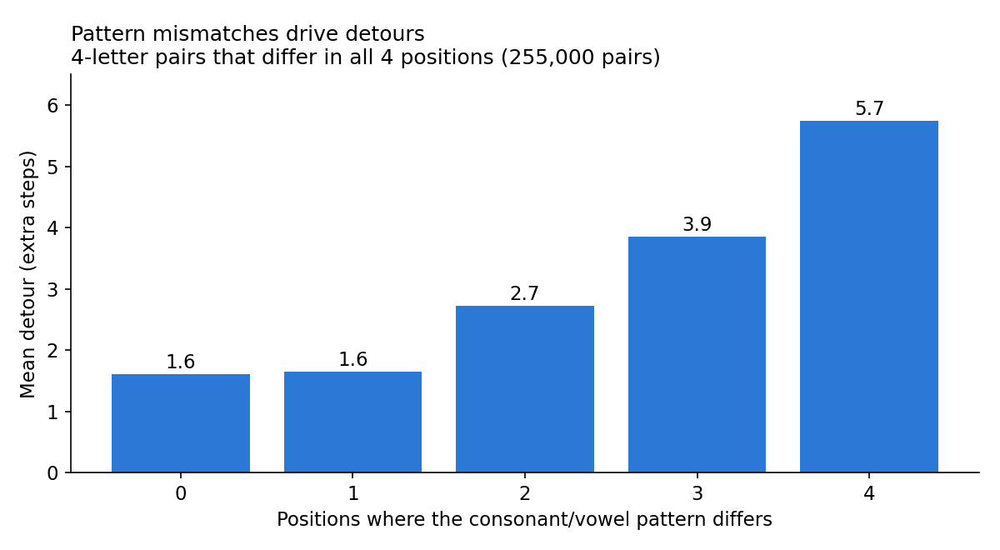
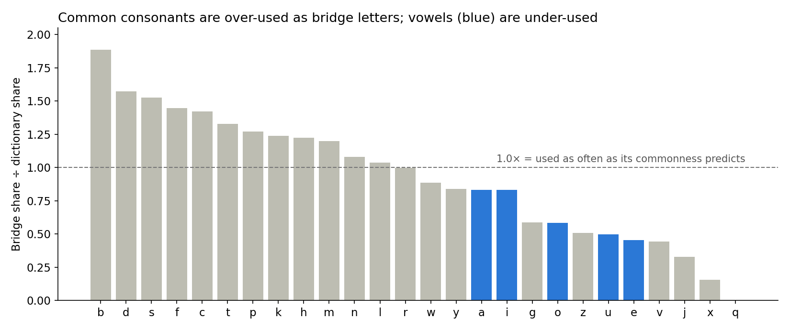
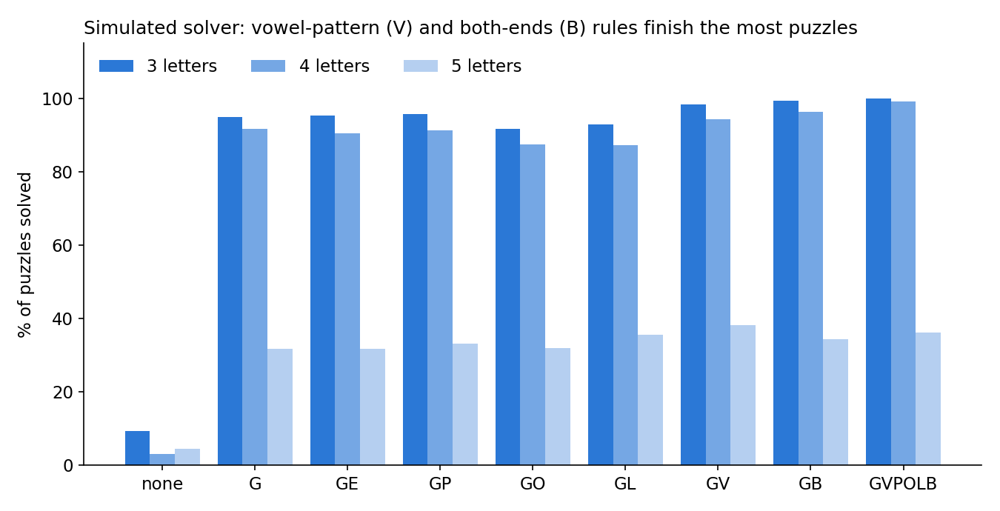

# Word Ladder Strategy Study

What patterns help a person solve word ladders? This analysis solves every pair of common 3-, 4- and 5-letter nouns exactly (1,095,747 pairs), analyzes what shortest ladders look like, benchmarks computer search strategies, and simulates a human solver to test practical habits.

**Short answer:** watch the consonant/vowel pattern, and build from both ends.

The full write-up is in [`word_ladder_report.txt`](word_ladder_report.txt).

## Key findings

### 1. Vowel/consonant patterns drive difficulty

With word length and the number of differing letters held fixed, every position where the consonant/vowel pattern differs adds detour steps. One mismatch costs little; two or more cost a lot.



### 2. Common consonants make the best temporary letters

The most-used bridge letters (letters in neither the start nor end word) are a, e, s, t, l, r and n, which is close to the "r, s, t, l, n, e" prediction. But relative to how common each letter is, consonants like b, d, s, f, c and t are over-used, and vowels are under-used.



### 3. More letters in common helps, but only in the same position

Each matching position shortens the ladder and reduces detours. Letters shared in *different* positions make ladders longer: anagram-like pairs are harder, not easier.

### 4. Shortest ladders have a shape

- Matching vowels are almost never changed (0.1–4% of ladders).
- The first and last letters do most of the temporary work.
- Vowel↔consonant changes happen mid-ladder; detours happen near the ends.
- The most common swaps are vowel for vowel: a↔o, a↔e, a↔i.
- Words with x, j, q or z are often unreachable.

### 5. Simple rules make a huge difference for people

A simulated solver with one-step lookahead and limited memory solves 6% of puzzles choosing at random, 73% by always moving toward the target, and 78% with vowel-pattern and both-ends rules added (99–100% of 3- and 4-letter puzzles).



Rule letters: **G** make progress · **V** fix the vowel pattern · **E** ends first · **P** protect matching vowels · **O** detour through outer letters · **L** detour through common letters · **B** build from both ends.

### 6. For computers, plain BFS wins

| Algorithm | First ladder is shortest | Relative work | Speed |
| --- | --- | --- | --- |
| Breadth-first search | Always | Baseline | Fastest in practice |
| Guided best-first (strategy G) | 89% / 61% / 34% (3 / 4 / 5 letters) | ~6× less | Similar |
| A* | Always | 3–4× less | Similar, slower at 5 letters |
| Branch and bound | Ends shortest; first try rarely | Far more | 35× to hundreds of times slower |

## How to solve a word ladder

1. **Compare vowel patterns** (e.g. "cold" = CVCC). Two or more mismatches mean a detour is coming.
2. **Work from both ends**, aiming each side at the other's latest word.
3. **Fix a letter whenever you can**, preferring fixes that line up the vowel pattern.
4. **Leave a matching vowel alone.**
5. **When stuck, borrow an outer consonant**: swap the first or last letter for b, d, s, t, c or p.
6. **Don't lock the first and last letters early.** Detours need them.
7. **Tidy up**: if two non-adjacent words differ by one letter, cut out the words between.

## Repository contents

| File | Description |
| --- | --- |
| `common_words_3_to_5.csv` | 5,178 common words used as in-between steps |
| `common_nouns_3_to_5.csv` | 2,382 singular nouns used as puzzle words |
| `make_common_words.py` | Rebuilds the common-words list |
| `word_ladder.cpp` | Finds every shortest ladder (random pairs or `--all-pairs`) |
| `analyze_ladders.py` | Hypothesis and move analysis |
| `ladder_strategies.cpp` | Computer strategy benchmark: BFS, branch and bound, A* |
| `human_solver.cpp` | Human-like solver simulation |
| `word_ladder_report.txt` | Full report |
| `images/` | Charts used in this README |

## Usage

Requirements: a C++17 compiler, Python 3 with `pandas` (and `wordfreq` to rebuild the word list).

```bash
# compile
g++ -O2 -std=c++17 word_ladder.cpp -o word_ladder
g++ -O2 -std=c++17 ladder_strategies.cpp -o ladder_strategies
g++ -O2 -std=c++17 human_solver.cpp -o human_solver

# solve every pair and analyze (output ~270 MB, analysis ~2 minutes)
./word_ladder common_nouns_3_to_5.csv --all-pairs --dict common_words_3_to_5.csv
python3 analyze_ladders.py ladders_all_shortest.csv common_words_3_to_5.csv --out results

# benchmark computer strategies
./ladder_strategies common_nouns_3_to_5.csv --dict common_words_3_to_5.csv --sample 300

# simulate a human solver
./human_solver common_nouns_3_to_5.csv --dict common_words_3_to_5.csv
```

Each program prints its options when run without arguments, and documents them at the top of its source file.

## Limitations

- With common words as in-between steps, 76% of 5-letter pairs have no ladder, so 5-letter results are the least reliable.
- Timings depend on hardware; "words expanded" is the more reliable comparison between strategies.
- The human model is simplified (one-step lookahead, no end-of-puzzle tidying) and has not been validated against real solvers.

## Data sources

- Dictionary: [ENABLE word list](https://github.com/dolph/dictionary)
- Word frequency: [wordfreq](https://github.com/rspeer/wordfreq)
- Parts of speech: [WordNet](https://wordnet.princeton.edu/) via NLTK
